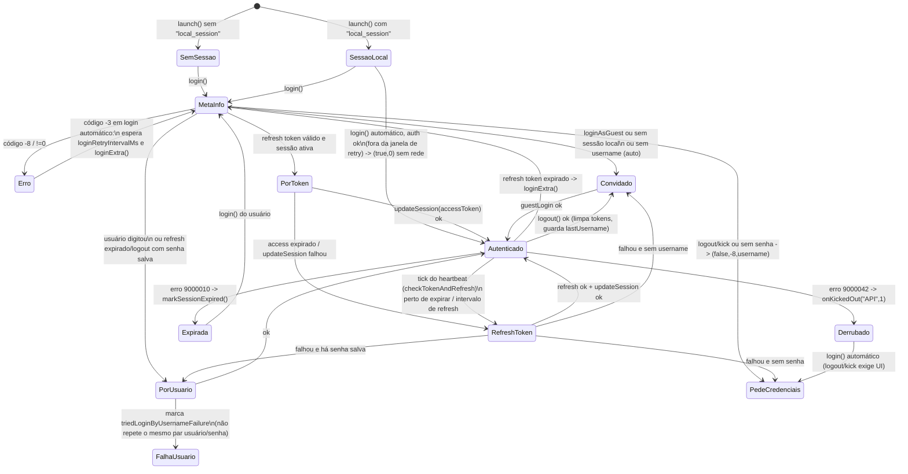

# Fluxo de autenticação (com.live.evo / baselib)

Reconstruído de `x1/f1/lb/user/*` (UserManager = `user/f`, PTV3AAdapter = `user/d`,
AAAAdapterFactory = `user/b`, SessionConverter = `user/g`). Código em
`src/main/java/com/foxivid/baselib/user/`.

## Peças

| Peça | Papel |
|---|---|
| `UserManager` | estado global da sessão, decisões de login/refresh/logout, engine |
| `AccountAdapter` | contrato de backend; `AAAAdapterFactory.getAdapter()` devolve sempre o `PTV3AAdapter` |
| `PTV3AAdapter` | chama `PTVApi3AClient` (Retrofit + Sandwich) e converte em `Triple(ok, código, msg)` |
| `SessionConverter` | resposta → `LocalSessionInfo` → `UserManager.setLocalSessionInfo` |
| `Preferences` (SPUtils) | SharedPreferences `"config"`; chave lógica gravada como MD5 (ex.: md5(`"local_session"`)) |
| `Installation` | did = `UUID.nameUUIDFromBytes(cpuSerialOuMac + mac)` gravado em `INSTALLATION` |

## Inicialização

```
App -> UserManager.launch(dir)
        ├─ did = Installation.id(dir)        (arquivo INSTALLATION / prefs)
        ├─ DeviceInfoCollector.putDid(did)
        ├─ getMark()                         (AES/ECB com chave derivada de "*(^*&65Gikljio")
        ├─ lê prefs de lembrete (um_*) e latest_login_renew_code_in_um
        └─ loadLocalSessionInfo()            (JSON Gson em "local_session")
               └─ access token válido? -> libera latch (isInitComplete)
```

## Máquina de estados da sessão



Ao chegar em **Autenticado** pela primeira vez (conversor com `isLogin=true`):
`fireLoginComplete(oldUid)` → recarrega referral se o uid mudou, `MediaConfigUtils.initUserData`,
propriedades Firebase, `queryProperty`, libera o latch, posta `LoginCompleteEvent` (sticky) e
`initUser()` (zera flags de kick/expiração, recarrega canais e VoD).

## Detalhes de cada caminho

- **queryMetaInfo** (`PTVApi3AClient.queryMetaInfo`): o payload (Map) vai para
  `HeartbeatManager.applyProperties` e `ServerProviderUtils.applyProperties` (config remota e servidores).
- **Conversor padrão** (`AAAAdapterFactory.createSessionConvertor`): `errCode 0` grava sessão;
  `10100035` → `(false,-8)` (exige vincular/entrar com usuário); demais → falha.
  Toda falha é enviada ao **bot do Telegram** (`"[auth] failure\nerr_code:..."`).
- **Senha**: sempre MD5 hex antes de sair do aparelho (`CommonHelper.md5`).
- **Login por código** (`loginByCode`): no PTV devolve `-2 "api not support"`; bloqueado com `-10`
  se dias restantes > `limitContinuingRenewDays`.
- **Logout**: sucesso → `isLogout=true`, apaga access/refresh/stream token e contatos, persiste e
  faz **guest login imediatamente** (o app nunca fica sem sessão). Código `-9` do servidor = sucesso.
- **Engine**: `startEngine(playType)` exige `streamServers` da sessão; sem servidores →
  bot `[no_stream_server]`, `NoStreamServerEvent`, re-login. Mudança de usuário em
  `setLocalSessionInfo` reinicia o engine (`ReplayEvent "restart_engine_um"`); mesmo usuário só
  empurra o novo stream token. Stream token expirado → `onStreamTokenExpired()` → re-login
  com throttle → `ReplayEvent "token_expire_re_login"`.
- **Códigos internos** do `Triple`: `0` ok, `-1` resposta nula, `-2` não suportado, `-3` exceção
  de rede, `-8` precisa de UI (msg = username), `-9` logout tratado como ok, `-10` limite de
  renovação, `-11` auto-login já falhou (não repetir).

## Identidade do aparelho enviada ao servidor

- `did` (UUID v3 de cpu_serial/MAC), `mark` (AES-128/ECB/ZeroBytePadding de
  `tenantId:brandId:canal:appType:appId:accountId:did:appVersion`, hex maiúsculo; nenhum
  consumidor encontrado no código decompilado), mapa de propriedades do `DeviceInfoCollector`
  (Build.*, MACs, android_id, CID do eMMC, serial da CPU, USID Amlogic, assinatura do firmware).
- URL do QR de assinatura: `memberShipUrl?t=<tenantId>&a=<accessToken>&d=<did>&l=<idioma>` —
  o access token vai em claro no QR.

## Lacunas

- `isInitComplete` (f.Q0) não foi decompilado pelo jadx; reconstruído do dump smali embutido.
- Em `execLoginFlow`, o jadx gerou dois ramos com a condição invertida para o erro `-3`; foi
  adotada a variante "automático ⇒ retry". Uma 2ª emissão no caminho "usuário" perdeu o argumento.
- O argumento de `MediaConfigUtils.initUserData(...)` em `fireLoginComplete` se perdeu.
- O diálogo de sessão (f.G1) tem corpo vazio no binário.
